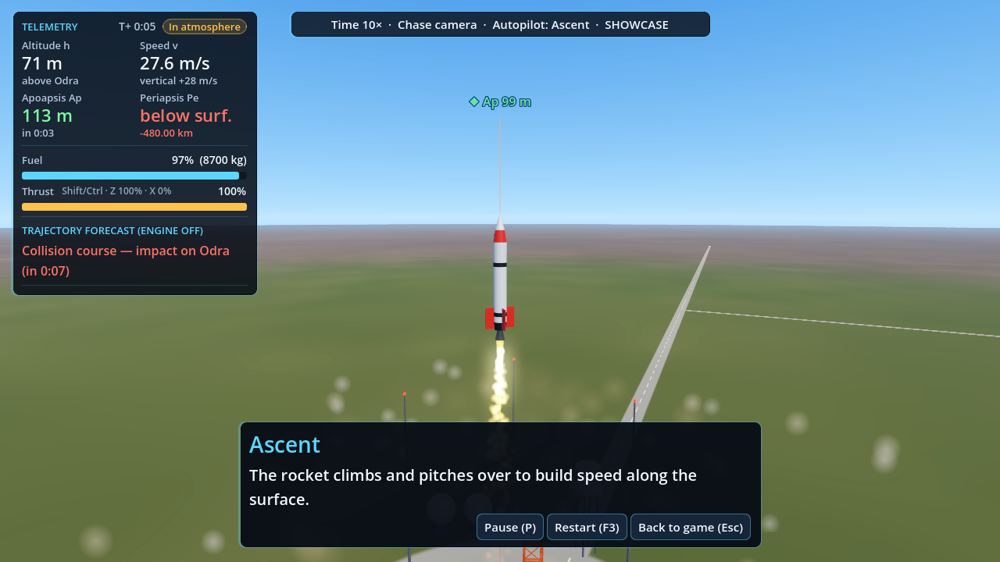
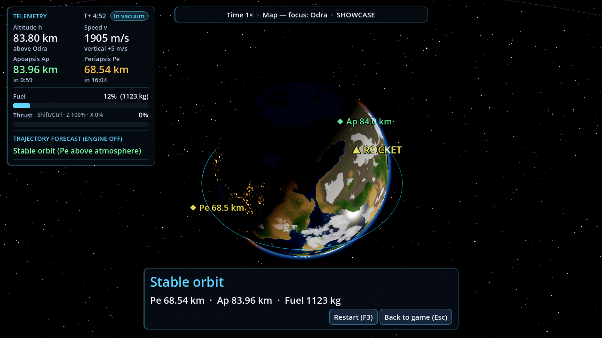

# Orbita Odra

An interactive 3D rocket flight and orbital dynamics simulator, built as a university coursework demo
for the Multimedia / AR / VR course at Wrocław University of Science and Technology.
The player flies a rocket from a launch pad into orbit around **Odra**, a fictional, downscaled planet with
a moon called **Ślęża**. The game shows the predicted trajectory, live telemetry, and how world parameter changes affect the flight.

Built with **Godot 4.7, GDScript and the Compatibility renderer (OpenGL 3.3)**. All meshes, materials, sky
and sound are generated procedurally. There are no external assets or add-ons.





## Running

You need Godot 4.7 on `PATH` as `godot`.

```sh
godot --path .            # play (main scene: res://game/main.tscn)
godot --path . -e         # open the editor
```

On Windows you can run `Launch.cmd`. It imports the project on first start, then launches the game and passes
any arguments on to the game, e.g. `Launch.cmd --showcase`.

### Automatic showcase (F3 / `--showcase`)

Press **F3** at any time, or click *Automatic showcase* on the welcome screen, to watch a narrated, autopilot-driven
launch to a stable orbit. The showcase runs on a separate simulation, so your current flight and settings are
restored when you leave it. **P** pauses, **F3** restarts, **Esc** returns to the game.

```sh
godot --path . -- --showcase
```

### Command-line options

Pass these after `--`:

| Option | Effect |
|---|---|
| `--showcase` | start the automatic showcase |
| `--preset=pad\|orbit\|transfer` | start on the pad / in a 100 km circular orbit / on a transfer to Ślęża |
| `--warp=1\|5\|10\|50` | time warp |
| `--autopilot` | deterministic launch autopilot (same as F2) |
| `--map` | start in the orbital map view |
| `--no-intro` | skip the welcome screen |
| `--quit-after=<s>` | quit after `<s>` seconds of simulation time and print `RESULT {json}` |
| `--screenshot=<file.png> [--shot-frame=N]` | save frame N (default 120) and quit |

Headless run example: `godot --headless --path . -- --autopilot --warp=10 --quit-after=600`.

## How to reach orbit

1. **Z** gives full thrust and the rocket lifts off vertically (TWR ≈ 1.6).
2. From about 1 km, hold **W** to pitch east: ~60° above the horizon at 10 km, ~30° at 25 km, ~10° at 40 km.
3. When **Ap** (the marker on the predicted path) reaches ~85 km, press **X** to cut the engine.
4. Coast to Ap (**3** = 10× time). Just before Ap, press **T** (hold prograde) and **Z**.
5. Cut the engine once **Pe** is above 60 km, the top of the atmosphere. The forecast then reads "Stable orbit".

The *Next step* panel at the bottom of the screen gives a hint for each stage of the flight.

## Controls

| Key | Action |
|---|---|
| W / S | pitch (W = nose east on the pad) |
| A / D | yaw |
| Shift / Ctrl | throttle up / down |
| Z / X | full thrust / cut-off |
| T / G | hold prograde / retrograde (WASD cancels) |
| 1–4, `,` `.` | time warp 1× / 5× / 10× / 50× |
| P / Esc | pause (world settings still work while paused) |
| C / M | chase camera ↔ orbital map |
| F | map focus: Odra / rocket / Ślęża |
| Mouse | drag to rotate the camera, wheel to zoom |
| R / O / K | reset to pad / 100 km orbit / transfer to Ślęża |
| F2 | launch autopilot |
| F3 | automatic showcase |
| Tab | rocket and world settings panel |
| F1 | controls help |

## Headless checks

The deterministic physics self-check runs without a window. It prints one JSON object per check plus a summary, and
exits with code 0 when every check passes.

```sh
godot --headless --path . --editor --import                    # first run only
godot --headless --path . --script res://game/tools/selfcheck.gd
godot --headless --path . --fixed-fps 60 -- --showcase --quit-after=420   # showcase smoke run, prints RESULT {json}
```

## Project layout

```
game/
  main.gd / main.tscn   composition root: fixed-step loop, time warp, input, CLI, showcase
  physics/              scene-independent physics (SI units, float64): config, simulation,
                        trajectory prediction, orbital elements, ascent autopilot
  visuals/              planet, rocket, trajectory, cameras, procedural shaders
  audio/                generated engine and wind sound
  ui/                   HUD, settings panel, shared UI styling
  tools/selfcheck.gd    headless physics self-check
```

The visual and UI layers read the simulation state but never change the physics directly. UI actions go through
signals that `main.gd` handles.

## Physics model and limitations

- The rocket is a variable-mass point with a kinematic orientation (3 degrees of freedom). The forces are planet
  and moon gravity, including the indirect term of the planet-centred frame, plus thrust and drag in an
  exponential atmosphere with a hard cut-off at 60 km.
- The integrator is Kick-Drift-Kick leapfrog with a fixed 1/60 s step. Time warp runs more steps per tick; it
  does not make the step longer.
- The trajectory forecast integrates the same force model with the engine off and an adaptive step. It is a
  preview only and is not strictly symplectic.
- These simplifications are intentional:
  - The planet does not rotate and there is no wind.
  - Thrust and Isp do not depend on ambient pressure, and the drag coefficient is constant (no Mach effects).
  - Attitude changes at a fixed rate, without moments of inertia.
  - The rocket has a single stage.
  - The moon follows a prescribed circular orbit and is not affected by the rocket.
  - The moon's sphere of influence is used only for telemetry and classification. The physics always computes
    both bodies.
- Odra (480 km radius, surface gravity ≈ 9.0 m/s²) and Ślęża are fictional bodies scaled so that a flight to
  orbit takes a few minutes. The numbers are not those of any real planet.
